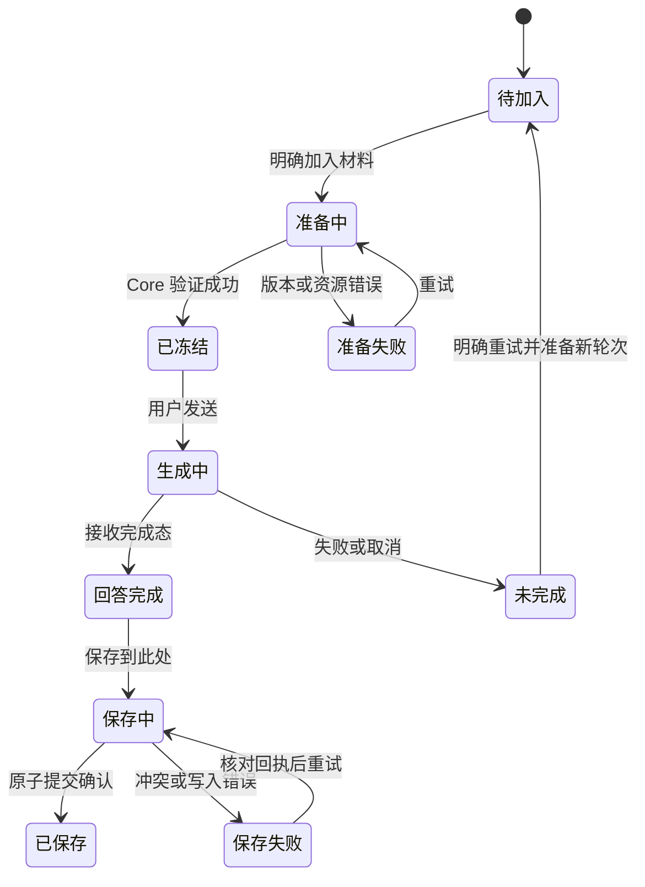

# 无限画布与 AI 知识问答：产品与交互设计

状态：阶段 A 已实现，分层验证见[实施记录](../verification/2026-10-20-canvas-inquiry.md)。阶段 B 首个切片已接入问题卡片、结论历史、关联会话与冻结材料续问，协议见[问题卡片决策](../decisions/0009-question-cards.md)，本轮检查见[问题卡片记录](../verification/2026-10-20-question-cards.md)。自动材料更新差异清单与全局问题导航仍为后续设计；本分支实现不等于正式发布。

决策依据见 [ADR 0008](../decisions/0008-canvas-inquiry.md)。现有行为继续以[产品](../product.md)、[UI](../ui.md)与协议源码为准；本方案落地时再同步这些现行规范。本文不是新的接口 schema。

## 1. 产品主线

定位：**在无限画布上组织证据，与 AI 一起形成、核对并持续完善自己的理解。**

用户对外表达：**把阅读变成看得见、可追溯的思考。** 在无限画布上整理原文、连接观点，与 AI 一起追问和验证。

首个目标场景是单书深度阅读：读者发现一个问题，从不同页摘取相关材料，对比观点和适用条件，核对 AI 的回答，并保留自己的结论和下一步问题。画布保存研究结构，问答帮助推进研究，PDF 提供回查依据。

成功后的可见结果是一组可继续使用的材料、问题与结论。画布面积、卡片数量和聊天轮次仅反映操作量，不能单独说明用户形成了理解。


## 2. 当前基础与设计缺口

本节根据本轮源码与现行文档阅读记录，不表示运行验收。历史计划中的旧布局和未实施描述不直接作为当前事实。

| 环节 | 当前代码或规范基础 | 本方案新增目标 |
| --- | --- | --- |
| 阅读与采集 | 原文摘录、区域图像、稳定来源、连续原文定位 | 让材料明确服务于一次问题探究 |
| 组织 | 卡片、单层主题组、语义连线、临时比较 | 让明确的关系和主题意图进入 AI 上下文 |
| 提问 | 选定材料冻结、阅读状态与模型冻结、预算限制 | 任务快捷入口；严格区分所选材料与本书补充检索 |
| 保存回答 | `Notes.fromAnswer` 保存问题、模型、回答和来源快照；`App.openSavedNote` 打开材料栏中的笔记 | 同一次保存中放置到相关材料附近，并保存对象关联 |
| 再次使用 | 按书保存工作区与聊天会话 | 问题入口、分支追问、结论版本和恢复研究位置 |

需在实现前处理的契约缺口：

- [材料冻结](../../apps/core/src/question-materials.ts)已收集同次选中对象间的关系；[提示词构建](../../apps/core/src/context.ts)未把 section 的 `targetId` 一起输出，关系端点与材料内容的对应需要补全。
- 当前 `buildContext` 会加入本书搜索结果、来源所在页和阅读位置附近内容。仅修改 UI 标签无法获得“仅所选材料”的效果。
- [回答转笔记](../../apps/core/src/notes.ts)复制材料快照时去掉 section 的 `targetId`。需要新增可用时的对象关联，同时继续保留独立快照。
- 笔记进入问题材料时统一使用 `user-note`；后续需携带 AI 生成来源和编辑状态，避免原文、个人表达和 AI 输出在多轮整理后混淆。

## 3. 分阶段范围

| 阶段 | 交付范围 | 本轮状态 |
| --- | --- | --- |
| A：材料到回答的闭环 | 选区快捷提问、明确范围、正确的关系上下文、回答原位保存与材料关联 | 已接入，检查范围与未完成验收见实施记录 |
| B：持续探究 | 问题卡片、从结果继续追问、结论历史、材料版本变化提示、研究恢复入口 | 首个切片实现问题、结论版本、会话与冻结材料续问；最新材料差异清单及全局导航待实施 |
| C：规模化研究 | 主题概览、缩放摘要、多个研究问题复用材料；跨书作为独立项目研究 | 后续规划，未排期 |

阶段 A 继续一个 PDF 一个工作台，不增加新的画布引擎、自动全画布上传、OCR、云同步、多个笔记编辑器或自主改写画布的 AI。现有 500 张卡片、1000 条关系、5000 个绘图对象限制仍有效；“无限”描述自由空间，不承诺无限容量。

各阶段记录实际通过和未覆盖部分；现行规范同步已接入行为，不把实现与全面验收等同。阶段 B 剩余切片及 C 的设计不代表已实现。

## 4. 信息与对象规则

| 用户概念 | 含义与展示 | 保存与来源规则 |
| --- | --- | --- |
| 原文摘录 | 原文内容、页码、回源入口 | 不可直接编辑；绑定本书 PDF 来源 |
| 我的笔记 | 读者自己的理解、假设或评论 | 继续复用 Note 正文、编辑器和 revision |
| AI 回答 | AI 生成的可编辑笔记，带生成身份 | 保存完整回答、问题、材料与实际模型；编辑不抹掉生成来源 |
| 问题卡片（B） | 一个可持续追问的问题，显示当前结论与待办 | 正文复用 Note；稳定问题身份关联会话、轮次、材料和结论，不靠标题推断 |
| 主题组 | 空间组织和主题名称 | 保持单层、单组归属；同组不表示相互支持 |
| 材料关联 | 某份材料曾用于某轮回答 | 来自冻结的使用记录；不等于支持结论 |
| 语义关系 | 用户声明的支持、反驳、补充、对比或待验证关系 | 保留声明者与说明；AI 建议需采纳后才成为持久关系 |

“已核对”仅表示用户记录了自己的核对动作，不代表系统验证了结论真伪。阶段 A 不增加自动正确性评分，也不把生成完成显示为“结论已验证”。

来源线、材料使用关联和语义关系保持独立含义，不共用一条含糊的“关联”数据。布局、软桥、颜色、距离与左右位置不自动升级为语义关系。

## 5. 阶段 A：完整操作流程

### 5.1 从材料开始

示例：用户从第 12、37、64 页摘出三段材料，想判断作者的几处观点是否一致。

1. 框选或 Ctrl/Shift 多选三张卡片，显示现有选区操作条；单纯选中不打开聊天。
2. 点击“问 AI”，展开紧凑动作菜单。单卡优先“解释”；多卡优先“比较”；通用入口保留“自定义问题”。
3. 选择“比较”后，打开现有问答浮窗，显示待加入清单、可编辑问题和回答范围，不立即调用模型。
4. 点击“加入材料”，Core 按书、对象版本和资源验证并冻结材料；准备完成后显示实际材料与关系数量。
5. 用户检查并编辑问题，点击“发送”；阅读状态、范围、模型与材料集合一起冻结到本轮。
6. 回答完成后，用户可以预览出处、前往连续 PDF 并返回，然后点击“保存到此处”。
7. 系统保存回答笔记、放置位置与材料使用关联，显示“已保存到画布”及撤销入口。

材料列表或主题组也使用同一流程。主题组必须先展示成员，用户明确选择并加入；新增成员或折叠状态变化不会悄悄改变已冻结材料。

### 5.2 快捷提问与草稿保护

| 动作 | 适用选择 | 问题草稿示例 | 回答组织建议 |
| --- | --- | --- | --- |
| 解释 | 一份或多份材料 | 请解释所选材料中的核心概念，并区分原文表述与补充解释。 | 核心意思、必要概念、不确定处 |
| 比较 | 至少两份可读材料 | 这些材料的观点是否一致？请比较定义、适用条件和差异，说明是否真的矛盾。 | 共同点、差异、成立条件、待核对处 |
| 检查依据 | 用户明确指定一份笔记作为待检查观点，另选材料 | 请检查这条观点能否由其余材料支持，指出依据不足或推断跨度。 | 有依据的部分、缺少依据的部分、建议核对处 |
| 自定义问题 | 任意合法材料集合 | 保持用户输入 | 不强制结构 |

“检查依据”不得仅凭卡片位置猜哪张是结论；若选择不明确，菜单内让用户指定。主题组整理、关系建议和自动提炼多个结论卡片留待后续，不挤入阶段 A。

以上是可编辑的问题草稿与输出提示，不强制把模型回答解析为结构化事实。阶段 A 保存完整回答，卡片展示现有轻量预览；用户可以在已有唯一编辑器中精简正文，不额外调用模型生成未经核对的摘要。

已有非空问题草稿时，保持原文，在浮窗中提供“追加此问题”或“替换问题”两个明确操作。未选择前不得覆盖。已有材料保持冻结版本；重复加入只提示“已加入”，不自动更新。

切换会话或书籍时，异步材料结果只能回到原 book/session 草稿。批量冻结尚未完成时禁用发送；部分失败显示已准备和失败项，允许重试或明确移除失败项，不能静默发送一个缩小后的材料集合。

### 5.3 回答范围

范围使用一个入口展示，避免“选区/章节/全书”与新范围形成两个看似矛盾的控件。

| 范围 | Core 可用证据 | 用户可见说明 |
| --- | --- | --- |
| 仅所选材料 | 本轮明确加入的冻结内容及其严格对应的原文证据；用户图片作为图片材料 | 只分析这 N 项材料；信息不足时明确说明 |
| 结合本书检索 | 所选材料，加本书内按问题检索的补充证据 | 允许从本书查找补充依据，仍受上下文预算限制 |

从画布快捷动作进入时默认“仅所选材料”。普通阅读提问继续保留已有自动／选区／章节／全书范围，在同一范围浮层中归入“阅读范围”；选择“结合本书检索”时将其作为检索策略，而不声称全书已全部发送。显示的当前有效策略只有一个。更改策略不改变已经发送的轮次。

严格范围必须满足：

- 不自动加入当前 PDF 页、相邻片段、主题组未选成员、全书导航摘要、会话记忆或旧对话。续问所需旧回答必须显式加入并标为 AI 内容。
- 原文引用只能覆盖选定锚点与实际冻结文字。Core 可读取本书 PDF/索引用于验证这些锚点，但不能把同页其他段落作为模型输入。无法可靠裁出对应文字时，提示该项不能提供已核验文字引用，允许按图片材料分析或由用户主动扩大范围。
- 图像保留“区域图像”“含个人标记”等身份，不能因图片有页码就生成原文文本引用。
- 模型请求、后续工具调用和引用校验共用同一冻结范围策略；不能通过工具搜索绕过限制。
- 没有有效材料时禁止发送此范围的问题，提示添加材料或明确切换范围；不能自动回退为全书检索。
- 本书补充检索在来源详情中区分“所选材料”和“补充检索”；模型自身常识必须标为补充解释，不冒充原文。

预算沿用约 12000 文本 tokens、20 项材料、4 张图片的现有上限。加入前展示预计数量，冻结后展示实际数量；关系与图片仍计入上限。超限要求缩小集合或分次提问，不能静默丢弃材料、自动概括后替换原文或扩大预算。

### 5.4 文字线框与信息层级

```text
画布： [摘录 A · p12]   [摘录 B · p37]   [摘录 C · p64]
       └────────── 多选：问 AI ▾ ───────────────────┘

问答浮窗（复用已有可移动、可缩放浮窗）
┌────────────────────────────────────────────┐
│ 会话名称                         历史  ⋯  × │
│                                            │
│ 问题与回答流                                │
│ 原文出处：12、37、64        保存到此处  ⋯    │
│                                            │
│ 仅所选材料 ▾          已加入 3 项 · 查看     │
│ 这些材料的观点是否一致？                     │
│ 请比较定义、适用条件与差异。                 │
│ 添加材料                 模型入口    发送   │
└────────────────────────────────────────────┘

保存后：原材料旁出现 [AI 回答 · 问题标题]
                    [正文轻量预览]
                    [来源页码 · 使用材料 3 项]
```

状态、材料数量和有效范围优先可见；版本、模型细节和来源全文按需展开。浮窗不因选中卡片反复移动。复用现有 IconButton、Popover、MaterialKind 和浮窗组件；颜色之外用文字、图标和焦点区分身份。

窄窗继续原文／画布页签；材料草稿与回答不因切页签丢失。保存成功后提供“查看卡片”，不强制把正在核对的 PDF 切走。所有动作可用按钮和键盘完成，IME 与编辑器快捷键继续优先。

### 5.5 回答原位保存

“保存到此处”只有回答完整结束且有正文时可用；生成中、已取消或失败状态保留聊天内容与重试入口，不保存为完整回答成果。已有“存为笔记”保留在更多菜单中。

落点由发起问题时保存的画布对象 ID 与世界坐标边界决定，不能使用回答完成时的任意新选区。保存时若原对象还存在，优先在这些对象当前整体边界右侧寻找可用空位，随后尝试下方，不移动原对象。全部原对象已删除或没有画布起点时，使用发起时边界或当前画布可用位置，并让用户可以选择落点。画布变更导致冲突时重新计算建议位置，但不重取历史材料正文。

结果不自动加入主题组，避免接触分组或成员变化改写用户结构；用户可再移入组。长回答用现有笔记预览，点击展开编辑；不创建第二份卡片正文。

保存以本书轮次为身份复用现有回答笔记：

- 首次保存：在一笔书籍命令中创建 Note、位置及本轮材料使用关联，全部成功后反馈。
- 已存为笔记但未放置：复用 Note 并放置；已被用户编辑的正文保持不变。
- 已放置：定位已有卡片，不重复创建、不擅自移动。
- 响应丢失后重试：使用同一命令标识核对回执，不生成重复笔记或卡片。
- 保存失败或版本冲突：保留回答和保存意图，显示重试；不得把半完成状态显示为成功。
- 一次撤销只恢复本次保存前的状态。复用笔记时不删除旧笔记；首次新建时保留可恢复逆操作。若后续编辑导致版本不符，拒绝破坏性撤销并保留内容。

选中回答卡片时可显示本轮材料使用关联，默认不把全画布所有关系铺开。所用对象被移出画布时不画悬空线，但仍可从材料详情查看；被删除时显示历史快照和“原对象已删除”。不自动连接全书检索命中的每个段落，也不自动创建“支持”关系。

## 6. 阶段 B：持续探究

问题卡片是一个轻量入口，显示问题、用户选定的当前结论、材料数，以及“继续探究”。完整对话在现有浮窗打开，卡片本身不挂载聊天窗口。用户可以在空白处创建问题，也可以把一次有价值的问答保存为问题入口。

目标流程：

1. 点击问题卡片的“继续探究”，恢复关联会话与研究区域，不自动发送。
2. 从上轮材料清单选择沿用的冻结版本，或显式“更新为最新材料”；显示新增、更新、缺失的项目。
3. 每次发送创建本轮快照，不复用已提交的 material ID。需要引用旧回答时，将其明确加入并保留 AI 来源。
4. 新回答可另存一个结论版本，用户选择哪份作为当前结论；不自动覆盖已有个人总结。
5. 从结果提出另一问题时，创建问题分支及其起点引用，原问题与原结论保持可查。

建议的问题状态是“待探索／探索中／已有结论／待复核”。“已有结论”由用户明确设置；生成成功不会自动切换。材料更新只提示“来源版本有变化”，不直接断言结论已错误，也不自动重跑模型。用户可以忽略变化、复核或明确把问题标为待复核。

问题卡片删除不连带删除证据或聊天；移出画布保留问题对象。问题 schema、会话绑定与删除恢复事务已按问题卡片决策定稿，首个切片实现目标流程 1、3、4、5；第 2 项已提供显式沿用冻结材料和画布加入最新内容，自动差异清单仍待实施。重开书籍恢复已有区域和问题卡片，不自动生成；“继续上次问题”及未完成问题的全局导航属于后续切片。

## 7. 阶段 C：材料增长后的导航

主题概览显示主题名称、用户选定结论和待解决问题数量。缩小画布时可以减少正文、突出这些信息；放大后恢复材料内容和来源。缩放只改变呈现，不生成或改写摘要；具体阈值通过原型验证后确定。

一份材料可以被多个问题引用，问题引用与单组空间归属分别保存。先允许多问题使用同一对象，再评估是否需要多位置投影，不通过复制原文制造多个独立版本。

跨书研究需要独立项目作用域、明确授权的多书材料集合、每份材料自己的 book ID/指纹及资源权限。它不能通过放宽现有单书 API 验证实现，也不属于阶段 A/B 的默认上下文范围。

## 8. 状态与异常处理



| 情况 | 规定行为 |
| --- | --- |
| 材料加入后修改 | 旧快照继续有效，显示版本变化；更新需显式操作 |
| 发送前原对象删除 | 已冻结内容保持可用；新冻结请求拒绝已删除对象 |
| 选区改变、卡片移动、主题成员变化 | 不改变本轮材料或问题草稿，不重新绑定保存起点 |
| 无账号、组件未就绪 | 可整理材料和编辑草稿；发送入口说明实际阻塞原因 |
| AI 超时或取消 | 保留问题和材料选择意图；重试创建新轮次快照，避免重复发送 |
| 返回响应时已切书 | 结果仅属于原书；不得放入新书、打开新书的编辑器或改变新书视口 |
| 保存失败后关窗／切书 | 持久内容草稿沿用现有退出保护；待保存意图给出重试或明确放弃，不误报已保存 |
| 达到卡片或关系容量上限 | 不执行部分保存；允许只存为笔记或由用户整理空间后重试 |
| 原文索引重建 | 来源按指纹与锚点定位；历史证据不依赖新索引 ID 重新解释 |

## 9. 架构与数据契约目标

以下是职责和字段语义建议，名称、序列化与格式版本在实施时定稿；当前协议版本不因本文改变。

| 责任 | 拟扩展位置 | 必须满足的边界 |
| --- | --- | --- |
| 快捷动作、草稿与保存起点 | `BookWorkspace`、`QuestionDrafts`、`ChatPanel` | book/session 隔离；UI 仅提交选择与意图 |
| 材料身份与关系映射 | Core `QuestionMaterials`、protocol 材料契约 | 每项有稳定引用、来源身份和冻结版本；关系端点必须可解析 |
| 回答范围 | Core `ChatService`、`buildContext`、Codex 工具边界 | 范围随轮次冻结；输入、工具、引用校验一致 |
| 回答保存并放置 | `BookEditingSession`、Core `BookCommands` 与笔记服务 | Note、位置、关联、回执与逆操作原子提交 |
| 来源与材料连线 | `features/connections` | 视图投影；不由几何生成持久语义关系 |
| 归档和历史来源 | Core 归档与资源服务 | 快照独立可读；复制恢复重映射有效引用，保留失效引用说明 |

阶段 A 需要保存：本轮有效范围、任务动作、发起时材料对象与位置提示、材料使用记录、来源身份。快照是历史依据；对象引用用于定位和变化提示。删除对象不会删除快照。

给模型的材料使用本轮局部编号，例如 M1/M2；关系明确表示端点、方向、标签和声明来源，Core 保留局部编号到冻结对象的映射。只含关系而缺少端点材料时先要求用户补选或移除该关系，不悄悄发送端点内容。分批加入时，由 Core 校验并冻结用户预览确认的关系集合；发送时不读取最新画布补充关系。

AI 笔记继续使用同一 Note 正文，不另建 AI 正文副本。上下文需要区分原文、个人笔记、AI 生成内容及其后续编辑；来源身份始终保留，不能因用户改了标题就变成原文。

新增持久引用与范围字段必须一起评估 schema、归档、删除／恢复、资源复制和旧格式处理。不延用历史“不兼容旧数据”的授权自行清库；若需要不兼容升级，实施前明确版本策略。归档仍不包含凭证或完整聊天；保存的回答笔记与冻结依据应可独立解释，缺少原会话时不提供无效的恢复聊天入口。

## 10. 实施切片与先决条件

| 顺序 | 切片 | 完成门槛 |
| --- | --- | --- |
| A1 | 正确的来源身份、关系端点与严格范围契约 | Core HTTP、上下文与 Codex 请求/工具边界证明无越界材料 |
| A2 | 选区快捷动作、草稿保护、范围与清单 UI | 真实 PDF/renderer 完成选择→冻结→发送，所有异步结果按书隔离 |
| A3 | 回答原位保存、幂等、关联与撤销 | Note/位置/关联同事务；故障重试与重启恢复通过 |
| A4 | 归档、窗口、容量及 Windows 验收 | 下表中阶段 A 门槛全部有本次记录，更新现行规范 |
| B1 | 问题卡片、结论与冻结材料续问 | 本分支实现；检查见问题卡片记录，未宣称覆盖 B 的全部目标 |
| B2 | 最新材料差异清单与全局问题导航 | 本分支已实现；确认与恢复规则见 ADR 0010，实际检查见材料差异与导航记录；未合入／安装本切片 |

先验证严格范围与证据契约，再接入入口；避免界面先承诺系统尚未执行的范围。按需延伸现有书籍命令，不另起 renderer 直写通道，不开放当前禁用的编程工具。

## 11. 验收设计与观察指标

以下全部为未来验收要求，本轮未执行功能验证。仅模拟外部 Codex；Core HTTP、SQLite、PDF、渲染器与文件资源使用真实实现和隔离生成材料。

| 编号 | 场景 | 可观察通过条件 |
| --- | --- | --- |
| A-01 | 三页原文摘录→比较→发送→回源→保存→重开 | 原材料保持，只有一份回答卡片，来源和材料关联可解释 |
| A-02 | 快捷动作遇到已有问题草稿 | 不静默覆盖；追加/替换明确，取消保留原稿 |
| A-03 | 同页含选中与未选内容，严格范围提问 | 实际模型输入和工具可读内容均不含未选段落、旧对话或导航摘要 |
| A-04 | 切换为本书补充检索 | 来源详情区分所选与补充；过去轮次范围不变 |
| A-05 | 选中关系与不同来源笔记 | 每个关系端点正确对应材料；AI 身份保留；未选端点不偷偷加入 |
| A-06 | 多项冻结部分失败、预算或图片超限 | 发送前明确阻止，重试不重复添加，不静默丢项 |
| A-07 | 冻结后改正文/删对象/改组成员/移动卡片 | 本轮历史内容不变；保存起点不被新选区劫持 |
| A-08 | 原位保存时写入失败、响应丢失、重复点击 | 无半完成成功状态；重试同一结果；重启可核对回执 |
| A-09 | 先存笔记再原位保存，以及撤销/重做 | 复用同一 Note；旧正文不覆盖；撤销仅逆转本次操作 |
| A-10 | 准备/生成/保存期间切书和退出 | 无跨书结果；脏稿与失败意图不丢失；退出保护有效 |
| A-11 | 删源、重建索引、归档恢复为副本 | 冻结来源可读；有效引用重映射；失效会话与对象有明确说明 |
| A-12 | 窄窗、浅深主题、键盘、IME、不同 DPI | 输入/发送/保存/重试可触达，PDF 返回位置正确 |
| A-13 | 卡片容量边界及现有压力样本 | 无部分写入或静默丢失；记录实际帧率、内存和保存耗时 |
| B-01 | 新增证据后从问题继续追问 | 新轮次明确材料版本，旧结论不被覆盖，可切换结论历史 |

实施交付执行 typecheck、相关边界测试、完整测试和要求的 Windows Setup/Portable 构建及安装版验收，记录实际提交、命令、环境与未完成项。设计文档检查不替代这些门槛。

可用性观察优先记录：首次完成“比较并保存”的成功率与用时；用户能否正确说明当前回答范围；能否从结论回到对应原文；重开后恢复同一研究任务的用时；保存结果是否被用于后续问题。先用同一生成任务建立基线，再比较原型，不预设未经测量的提升百分比。初期用经用户同意的本地测试观察，不默认增加遥测。

## 12. 本轮文档交付边界

本节前述“仅修改文档”是设计阶段的历史范围，随后按用户授权实现阶段 A，并开始 B1 的问题卡片与结论历史。各阶段程序与文档的实际检查分别记录，不以设计图或历史测试证明当前功能可用。

设计阶段检查（2026-10-20）：`pnpm typecheck` 和文档增量检查通过，当时使用 Node 22.14.0 / pnpm 10.33.0。该结果仅属于设计文档阶段；后续实现使用找到的 Node 24.19.0，实际测试和构建以实施记录为准。

阶段 A 实施取舍：多选集合共用一次冻结请求，以便关系与材料在同一版本加入；界面逐项呈现，移除通过 Core 对原快照作排除投影，不重新冻结相邻材料。全部起点消失或无画布起点时先使用建议空位，沿用卡片拖动调整位置，不增加独立落点模态框。
